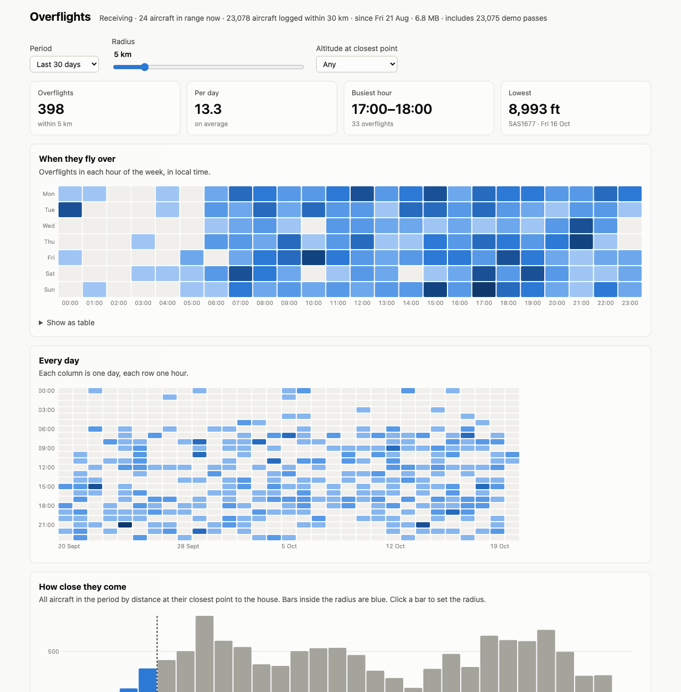

# Home Assistant Apps

[](https://my.home-assistant.io/redirect/supervisor_add_addon_repository/?repository_url=https%3A%2F%2Fgithub.com%2Ftimd%2Fha-apps)

Apps (formerly add-ons) for Home Assistant OS and Supervised installations.

| App | Purpose |
| --- | --- |
| [Overflights](overflights/DOCS.md) | Logs the aircraft that your ADS-B receiver sees pass over the house, and charts when and where they fly. |

## Overflights



Overflights reads `aircraft.json` from an ADS-B receiver that runs PiAware
(SkyAware), tar1090, readsb or ultrafeeder. It records each aircraft's
closest approach to the house, and gives you:

- heatmaps of overflights by hour of the week and by day;
- a histogram of how close aircraft come, to help you choose a radius;
- arrivals, departures and transits, sorted by each pass's altitude profile;
- a map of where the aircraft fly, coloured by class, with arrivals and
  departures traced to the runway;
- a table of the latest overflights;
- Home Assistant sensors over MQTT: overflights today, the last overflight,
  and whether the receiver is online.

The page opens from the Home Assistant sidebar. [DOCS.md](overflights/DOCS.md)
describes the options.

## Install

1. Click the button above, or open Settings → Apps → App store, choose
   **Repositories** from the menu, and add `https://github.com/timd/ha-apps`.
2. Install **Overflights**.
3. On the Configuration tab, set **Receiver data URL** to your receiver's
   data folder, and optionally **Airport** to the code of your nearest
   airport (for example `EDDB` or `BER`). Start the App.

All settings are in the Configuration tab's form; you do not need to edit
YAML. [overflights/README.md](overflights/README.md) has the full
installation and setup steps. Home Assistant shows it on the App's Info tab.

The App runs on amd64 and aarch64 (for example a Raspberry Pi 4 or 5).

## Release

1. Raise `version` in `overflights/config.yaml` and add an entry to
   `overflights/CHANGELOG.md`.
2. To refresh the airport data, run `scripts/build_airports.py`. It
   downloads OurAirports and rewrites `overflights/app/airports.json.gz`.
3. Push to `main`. The Build workflow lints the App and pushes
   `ghcr.io/timd/{arch}-overflights:<version>`. It never overwrites a version
   that exists.

## Develop

```bash
python3 -m venv .venv && .venv/bin/pip install aiohttp aiomqtt
mkdir -p /tmp/overflights && cat > /tmp/overflights/options.json <<'JSON'
{"receiver_url": "http://piaware.local/skyaware/data", "capture_radius_km": 30,
 "poll_seconds": 5, "retention_days": 365, "default_radius_km": 5,
 "default_max_altitude_ft": 0, "demo_data": true}
JSON
cd overflights/app && OVERFLIGHTS_DATA=/tmp/overflights ../../.venv/bin/python main.py
```

The page is then at http://localhost:8099/. Add `?theme=dark` or
`?theme=light` to override the system theme. Outside Home Assistant there is
no Supervisor, so the App publishes no sensors.

To run a development copy as a local App, `scripts/deploy-local.sh <ssh-host>`
copies `overflights/` to `/addons/overflights/` on the server without the
`image` line, so the Supervisor builds it from the Dockerfile.

## Credits

The icon uses the airplane glyph from [Material Design
Icons](https://pictogrammers.com/library/mdi/) (Apache License 2.0). The page
uses [Leaflet](https://leafletjs.com/) (BSD 2-Clause) and map tiles from
[OpenStreetMap](https://www.openstreetmap.org/copyright), served by the
[German OpenStreetMap association](https://www.openstreetmap.de/). Airport and runway
data come from [OurAirports](https://ourairports.com/data/) (public domain).

## Licence

MIT. See [LICENSE](LICENSE).
